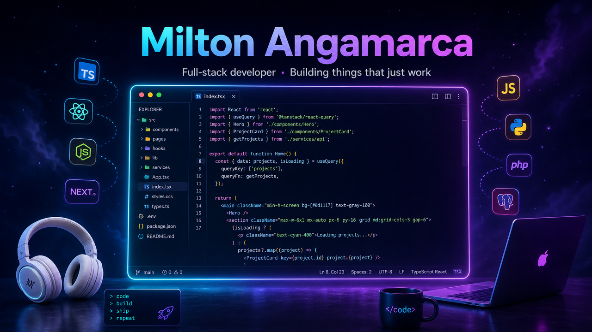
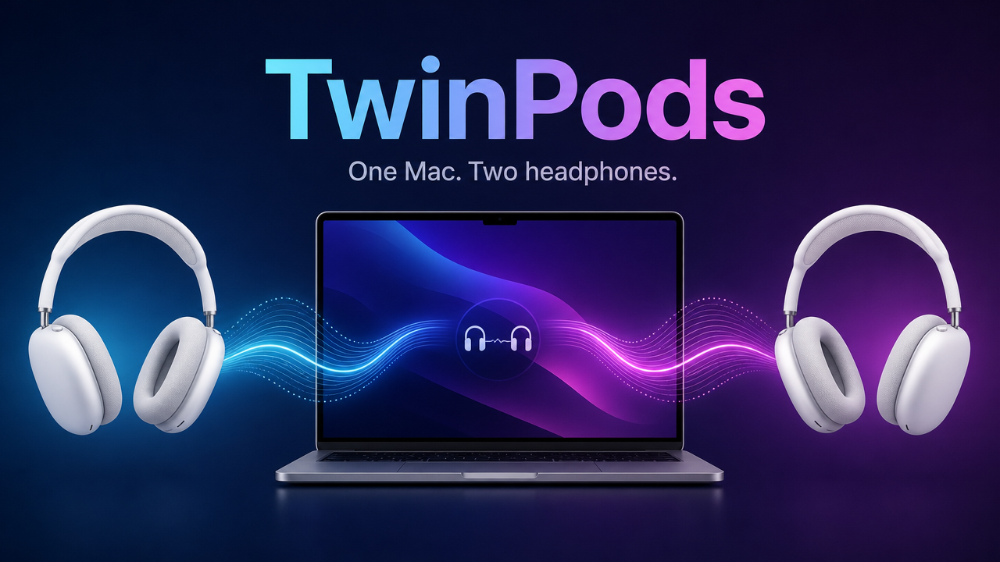

  

<h3 align="center">Full-stack developer · I like building tools that just work</h3>

  
  
  

---

## 🚀 Featured project

<table>
<tr>
<td width="55%">

### 🎧 TwinPods

A tiny macOS menu bar app that plays your Mac's audio through **two Bluetooth headphones at the same time**.
Built in Swift on CoreAudio, with zero dependencies. It detects connections live and turns itself off if a headphone drops.

`Swift` · `CoreAudio` · `AppKit` · `MIT`

**[→ Repo](https://github.com/xXxMiltonxXx/TwinPods)**

</td>
<td width="45%">

</td>
</tr>
</table>

---

## 🧰 Tech I work with

  

## 🧪 What I've built

- **Web platforms**: SaaS and full-stack apps with TypeScript, Node and Astro
- **Systems & infra**: reverse proxies, Dockerized apps and backup servers on Linux
- **IoT**: an air quality dashboard fed by MQTT
- **Mobile & desktop**: Kotlin, Dart and native macOS tools in Swift
- **Teaching**: TypeScript, JavaScript and Astro courses for a university Microsoft community

---

## 📊 GitHub stats

  
  

  

---

<i>Built with curiosity, shipped with coffee ☕</i>

