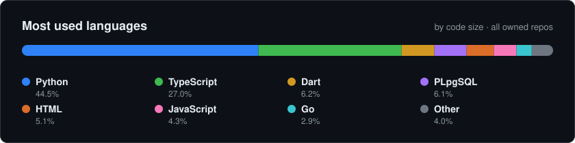

# Milton Angamarca

**AI systems engineer.** I build second brain systems, operations automation and LLM pipelines.

---

## About

```ts
const milton = {
  role: "AI systems engineer",
  focus: [
    "Second brain systems: persistent memory and knowledge for AI agents",
    "Operations automation for critical workflows",
    "LLM pipelines and agent orchestration",
  ],
  daily: ["TypeScript", "Python", "Node.js", "Astro"],
  alsoWrites: ["Rust", "Swift", "C#", "Go", "Kotlin", "Dart"],
  teaches: "TypeScript, JavaScript and Astro to a university community",
};
```

> Most of my current work lives in private repositories, so this profile only shows a fraction of it.

---

## Selected work

| Project | What it is | Stack |
| --- | --- | --- |
| [ProyectoCasaAbierta23-2](https://github.com/xXxMiltonxXx/ProyectoCasaAbierta23-2) | SaaS platform built from scratch with modern tooling | TypeScript |
| [ArtConnect_Back_end](https://github.com/xXxMiltonxXx/ArtConnect_Back_end) | Backend for the ArtConnect application | TypeScript |
| [CalidadAire](https://github.com/xXxMiltonxXx/CalidadAire) | Air quality monitoring: MQTT ingestion and a web dashboard | JavaScript, MQTT |
| [SistemaPizza](https://github.com/xXxMiltonxXx/SistemaPizza) | Full-stack pizzeria management system (PERN) | JavaScript |
| [Practica-Codigo-Proxy-inverso](https://github.com/xXxMiltonxXx/Practica-Codigo-Proxy-inverso) | Reverse proxy setup: Node.js, Apache and MongoDB on Rocky Linux | Node.js, Linux |
| [Portfolio-Milton](https://github.com/xXxMiltonxXx/Portfolio-Milton) | Personal portfolio site | Astro |

---

## Tech stack

<p>
  
</p>

---

## GitHub analytics

<p align="center">
  
</p>
<p align="center">
  
</p>
<p align="center">
  
</p>

<sub>Charts are generated by [`scripts/generate.py`](scripts/generate.py) from public GitHub data and refreshed daily.</sub>
